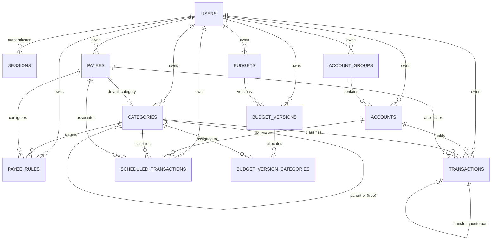
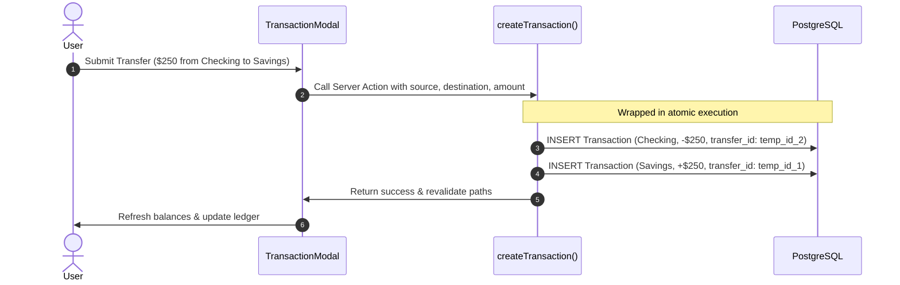

# Buddy Architecture & Technical Design

This document provides a deep technical overview of **Buddy**, explaining the system architecture, core engineering concepts, database design, domain algorithms, and internal data flows.

---

## 1. Architectural Philosophy & Overview

Buddy is engineered with three primary design principles:

1. **Multi-User Isolation & Self-Contained Auth**: All user financial records are stored in PostgreSQL and strictly isolated per user (`user_id` foreign keys across all domain tables). Authentication uses self-contained Email & Password credentials (`crypto.scrypt`) and database-backed sessions (`sessions` table) with no external third-party auth service dependencies.
2. **Server-First Execution with React Server Components (RSC)**: Buddy leverages Next.js 16's App Router architecture. High-cost database queries, category hierarchy rollups, and aggregations are computed on the server and streamed as server components, minimizing client-side JavaScript overhead.
3. **Type-Safe Domain Logic & Server Actions**: All data mutations (CRUD operations, reordering, CSV ingestion) are implemented as Next.js Server Actions (`'use server'`) with full end-to-end TypeScript validation through Drizzle ORM and server-side `requireUser()` session enforcement.

```
┌─────────────────────────────────────────────────────────────┐
│                    Browser Client Layer                     │
│  - React 19 Client Components ('use client')                │
│  - Optimistic State Updates & React Transitions             │
│  - Drag-and-Drop Reordering & Instant In-Memory Filtering    │
└──────────────────────────────▲──────────────────────────────┘
                               │ HTTP / Server Action RPC
┌──────────────────────────────▼──────────────────────────────┐
│                    Next.js App Router (RSC)                 │
│  - Next.js 16 Proxy Route Protection (proxy.ts)             │
│  - Server-Rendered Layouts & View Aggregations               │
│  - Authenticated Server Actions (lib/actions/*)             │
│  - Path Revalidation (revalidatePath)                       │
└──────────────────────────────▲──────────────────────────────┘
                               │
┌──────────────────────────────▼──────────────────────────────┐
│                    Domain Services & Logic                  │
│  - Authentication & Session Engine (lib/auth.ts)            │
│  - Category Tree Rollup Engine (lib/category-utils.ts)      │
│  - Payee Rule Evaluation Engine (lib/payee-rules.ts)        │
│  - CSV Normalization & Parser (lib/csv.ts)                  │
└──────────────────────────────▲──────────────────────────────┘
                               │
┌──────────────────────────────▼──────────────────────────────┐
│                   Drizzle ORM & Schema                      │
│  - Relational Mapping & Schema Definitions (pg-core)        │
│  - Type Inference ($inferSelect, $inferInsert)              │
└──────────────────────────────▲──────────────────────────────┘
                               │
┌──────────────────────────────▼──────────────────────────────┐
│                  PostgreSQL Engine (postgres)               │
│  - Connection Pooling via postgres.js (lib/db/index.ts)     │
│  - Per-User Foreign Key & Cascade Constraints               │
│  - Configured via DATABASE_URL                              │
└─────────────────────────────────────────────────────────────┘
```

---

## 2. Database Layer, Authentication & Schema Design

Buddy uses PostgreSQL via [`postgres`](https://github.com/porsager/postgres) (`postgres.js`) paired with [Drizzle ORM](https://orm.drizzle.team/).

### Database Connection & Pooling

On initialization (`lib/db/index.ts`):
- Connects using `process.env.DATABASE_URL`.
- **Singleton Client**: In development, `globalThis.__pgClient` preserves the PostgreSQL connection pool across Next.js Hot Module Replacement (HMR) reloads.

### Authentication & Tenant Isolation

- **Password Security**: Passwords are hashed using Node's `crypto.scrypt` with a 16-byte random salt and verified with `crypto.timingSafeEqual`.
- **Database Sessions**: Signing in generates a 32-byte random token, stores its SHA-256 digest in the `sessions` table, and sets an `httpOnly` cookie (`buddy_session`).
- **Tenant Isolation**: Every domain table (`account_groups`, `accounts`, `categories`, `payees`, `payee_rules`, `transactions`) carries a non-null `user_id` referencing `users.id` (`ON DELETE CASCADE`). Every Server Action calls `requireUser()` and scopes all queries and mutations by `userId`.

### Entity Relationship Model



#### Tables

1. **`users`**: Registered user accounts.
   - `id` (text, PK)
   - `email` (text, unique, not null)
   - `name` (text, not null)
   - `password_hash` (text, not null)
   - `created_at`, `updated_at` (timestamptz)

2. **`sessions`**: Active login sessions.
   - `id` (text, PK, SHA-256 hash of session token)
   - `user_id` (text, FK -> `users.id` on delete `CASCADE`)
   - `expires_at`, `created_at` (timestamptz)

3. **`account_groups`**: High-level groupings for accounts (e.g., *Everyday Banking*, *Investments*).
   - `id` (text, PK)
   - `user_id` (text, FK -> `users.id` on delete `CASCADE`)
   - `name` (text, not null)
   - `icon` (text, optional Lucide icon key)
   - `sort_order` (integer, default 0)
   - `created_at`, `updated_at` (timestamptz)

4. **`accounts`**: Individual financial accounts.
   - `id` (text, PK)
   - `user_id` (text, FK -> `users.id` on delete `CASCADE`)
   - `group_id` (text, FK -> `account_groups.id` on delete `SET NULL`)
   - `name` (text, not null)
   - `type` (text enum: `checking`, `savings`, `credit`, `cash`, `other`)
   - `icon` (text, optional Lucide icon key)
   - `sort_order` (integer, default 0)
   - `exclude_from_net_worth` (boolean, default false)
   - `credit_limit_cents` (integer, optional)
   - `balance_display_mode` (text enum: `actual`, `available`, default `actual`)
   - `is_archived` (boolean, default false)
   - `created_at`, `updated_at` (timestamptz)

5. **`categories`**: Recursive self-referencing spending taxonomy.
   - `id` (text, PK)
   - `user_id` (text, FK -> `users.id` on delete `CASCADE`)
   - `parent_id` (text, FK -> `categories.id` on delete `CASCADE`)
   - `name` (text, not null)
   - `sort_order` (integer, default 0)
   - `is_archived` (boolean, default false)
   - `created_at` (timestamptz)

6. **`payees`**: Transaction counter-parties with default category mappings and priorities.
   - `id` (text, PK)
   - `user_id` (text, FK -> `users.id` on delete `CASCADE`)
   - `name` (text, not null; unique per `user_id`)
   - `default_category_id` (text, FK -> `categories.id` on delete `SET NULL`)
   - `priority` (integer, default 1; 0=Highest, 1=Standard, 2=Low, 3=Archived)
   - `created_at` (timestamptz)

7. **`payee_rules`**: Conditional amount-based categorization rules per payee.
   - `id` (text, PK)
   - `user_id` (text, FK -> `users.id` on delete `CASCADE`)
   - `payee_id` (text, FK -> `payees.id` on delete `CASCADE`)
   - `category_id` (text, FK -> `categories.id` on delete `CASCADE`)
   - `operator` (text enum: `lte`, `gte`)
   - `amount_cents` (integer, not null)
   - `sort_order` (integer, default 0)
   - `created_at` (timestamptz)

8. **`transactions`**: Double-entry financial records and transfers.
   - `id` (text, PK)
   - `user_id` (text, FK -> `users.id` on delete `CASCADE`)
   - `account_id` (text, FK -> `accounts.id` on delete `CASCADE`)
   - `payee_id` (text, FK -> `payees.id` on delete `SET NULL`)
   - `category_id` (text, FK -> `categories.id` on delete `SET NULL`)
   - `amount_cents` (integer, signed; negative = outflow, positive = inflow)
   - `date` (text, `YYYY-MM-DD`)
   - `notes` (text, optional)
   - `is_cleared` (boolean, default true)
   - `exclude_from_budgets` (boolean, default false)
   - `transfer_id` (text, self-reference linking paired transfer record)
   - `created_at`, `updated_at` (timestamptz)

9. **`scheduled_transactions`**: Recurring scheduled transaction templates.
   - `id` (text, PK)
   - `user_id` (text, FK -> `users.id` on delete `CASCADE`)
   - `account_id` (text, FK -> `accounts.id` on delete `CASCADE`)
   - `payee_id` (text, FK -> `payees.id` on delete `SET NULL`)
   - `category_id` (text, FK -> `categories.id` on delete `SET NULL`)
   - `amount_cents` (integer, signed)
   - `frequency` (text enum: `weekly`, `fortnightly`, `monthly`, `yearly`)
   - `next_due_date` (text, `YYYY-MM-DD`)
   - `notes` (text, optional)
   - `is_active` (boolean, default true)
   - `created_at`, `updated_at` (timestamptz)

10. **`budgets`**: Top-level user spending budgets.
    - `id` (text, PK)
    - `user_id` (text, FK -> `users.id` on delete `CASCADE`)
    - `name` (text, not null)
    - `created_at`, `updated_at` (timestamptz)

11. **`budget_versions`**: Versioned configurations for a budget over time.
    - `id` (text, PK)
    - `budget_id` (text, FK -> `budgets.id` on delete `CASCADE`)
    - `user_id` (text, FK -> `users.id` on delete `CASCADE`)
    - `version_number` (integer, default 1)
    - `frequency` (text enum: `weekly`, `monthly`, `yearly`)
    - `amount_cents` (integer, not null)
    - `is_active` (boolean, default true)
    - `effective_from` (timestamptz, not null)
    - `effective_to` (timestamptz, optional)
    - `created_at` (timestamptz)

12. **`budget_version_categories`**: Join table mapping categories to specific budget versions.
    - `id` (text, PK)
    - `budget_version_id` (text, FK -> `budget_versions.id` on delete `CASCADE`)
    - `category_id` (text, FK -> `categories.id` on delete `CASCADE`)

---

## 3. Core Technical Concepts & Domain Logic

### 3.1 Monetary Representation & Currency Precision

- **Integer Cents**: Monetary values are **never** stored as floating-point numbers (`REAL` or `FLOAT`). All monetary calculations are performed in integer cents (`amountCents`).
- **Sign Convention**:
  - `amountCents < 0`: Outflow / Expense / Debit
  - `amountCents > 0`: Inflow / Income / Credit
- **Zero-Cents Protection**: Inputs in UI components (`CurrencyInput.tsx`) parse raw user input directly into integer cents using regex and round-half-up math to prevent rounding bugs.
- **Formatting**: `lib/utils/currency.ts` formats cents into localized currency strings based on the centralized `APP_CONFIG` in `lib/constants.ts`.

### 3.2 Credit Limits & Available Balance Calculation

Accounts can optionally define a credit limit (`credit_limit_cents`) and a display preference (`balance_display_mode: 'actual' | 'available'`):
- **Available Balance**: Calculated as $\text{availableBalanceCents} = \text{creditLimitCents} + \text{balanceCents}$.
  Because debts are signed negative (e.g., $-\$487.50$), an account with a $\$5,000.00$ limit yields an available balance of $\$4,512.50$.
- **Display Modes**:
  - `'actual'`: Prominently displays the current ledger balance (e.g. debt owed), with secondary notes indicating available credit.
  - `'available'`: Prominently displays the available credit capacity, with secondary notes indicating actual ledger balance.
- **Net Worth Invariance**: Net worth and balance aggregations across groups strictly sum actual balances (`balanceCents`), preserving financial integrity regardless of credit line limits.

### 3.3 Category Tree Hierarchy & Aggregation Engine

Categories are modeled as an **Adjacency List** with self-referencing `parent_id` pointers, supporting arbitrary tree depth (Roots $\rightarrow$ Subcategories $\rightarrow$ Sub-subcategories, etc.).

#### Recursive Metrics & Rollups (`lib/category-utils.ts`)

When categories are fetched (`getCategoryTree()` in `lib/actions/categories.ts`):
1. All active categories and raw direct transaction stats (`directSpentCents`, `directTransactionCount`) are loaded from PostgreSQL.
2. An in-memory tree of `CategoryNode` items is constructed using a parent-child adjacency map.
3. `processCategoryNode()` recursively traverses the tree:
   - Computes node `depth` (`0` for root, `1` for child, etc.).
   - Computes breadcrumb `path` (`['Housing', 'Utilities', 'Power']`).
   - Computes human-readable `fullPathName` (`"Housing > Utilities > Power"`).
   - Aggregates **rollup totals**:
     $$\text{totalSpentCents} = \text{directSpentCents} + \sum_{\text{child}} \text{child.totalSpentCents}$$
     $$\text{totalTransactionCount} = \text{directTransactionCount} + \sum_{\text{child}} \text{child.totalTransactionCount}$$

#### Category Subtree Filtering

When filtering transactions by category in `TransactionTable.tsx`, selecting a parent category (e.g. `Housing`) must match all transactions categorized under `Housing` **or any descendant subcategory**.
- The component precalculates an in-memory `categorySubtreeMap: Map<string, Set<string>>` where each category ID maps to a `Set` containing itself and all its descendant IDs.
- Ledger filtering checks `subtreeSet.has(transaction.categoryId)` in $\mathcal{O}(1)$ time.

### 3.4 Smart Payees & Rule Matching Engine

Payees are configured with a priority classification and conditional rules (`lib/payee-rules.ts`).

#### Payee Priority Tiers

| Tier | Priority | Semantic Meaning & Behavior |
|---|---|---|
| **Highest** | `0` | Quick-picks: displayed before user enters text in selection dropdowns |
| **Standard** | `1` | Standard auto-complete search results |
| **Low** | `2` | Deprioritized to bottom of suggestions |
| **Archived** | `3` | Hidden from selection comboboxes; retained on historical records |

#### Amount-Based Rule Evaluation (`resolvePayeeCategory`)

When a user selects a payee and enters an amount (or imports a transaction via CSV):
1. Checks the payee's rules against the absolute transaction amount $|amountCents|$.
2. Evaluates rules with operators:
   - `lte`: $|amountCents| \le \text{rule.amountCents}$
   - `gte`: $|amountCents| \ge \text{rule.amountCents}$
3. **Closest Threshold Matching**: If multiple rules match, Buddy sorts matching rules by mathematical distance to the threshold:
   $$\text{distance} = \big| |amountCents| - \text{rule.amountCents} \big|$$
   The rule with the minimal distance wins.
4. **Fallback**: If no rule matches, Buddy falls back to the payee's `defaultCategoryId`.

### 3.5 Double-Entry Linked Transfers

Transfers between accounts are executed as two synchronized atomic records:
1. **Source Outflow**: A transaction on `sourceAccountId` with `-amountCents`.
2. **Destination Inflow**: A transaction on `destinationAccountId` with `+amountCents`.
3. **Linkage**: Both records store the ID of the counterpart record in `transfer_id`.



When a user updates or deletes a transfer transaction, `transactions.ts` identifies the counterpart record via `transfer_id` and keeps both sides synchronized.

### 3.6 CSV Ingestion Pipeline

The CSV parser (`lib/csv.ts` and `lib/actions/csv-import.ts`) handles flexible bank statement imports:

1. **Header Normalization**: Strips spaces, underscores, and dashes, mapping varied bank headers to standard keys:
   - Date: `Date`, `TxDate`, `Transaction Date`
   - Description: `Description`, `Desc`, `Memo`, `Details`
   - Payee: `Payee`, `Merchant`, `Counterparty`
   - Account: `Account`, `Source Account`
   - Destination Account: `Transfer Account`, `Transfer To`, `Destination Account`
   - Amount: `Amount`, `Total`, `Sum`
2. **Date Normalization**: Parses formats (`YYYY-MM-DD`, `DD/MM/YYYY`, `MM/DD/YYYY`, `YYYY/MM/DD`, with or without timestamps) into strict ISO `YYYY-MM-DD`.
3. **Entity Reconciliation & Preloading**:
   - Existing accounts, categories, and payees are preloaded into memory before processing.
   - Lookups use normalized lowercase keys to prevent duplicates.
   - Missing accounts, categories, or payees are auto-provisioned in batch with sensible defaults.
4. **Note Merging**: Merges descriptions and memo fields using `\n\n` separators to preserve statement history.
5. **Rule Execution**: Evaluates payee categorization rules on imported rows before committing to the database.

### 3.7 Versioned Budgets, Period Progress & Pacing Engine

Buddy's budgeting system allows users to define spending targets across configurable calendar cycles (weekly, monthly, yearly) for one or more categories, track pacing against elapsed time, and maintain historical integrity across edits.

#### Budget Period Cycles & Boundary Alignment (`lib/utils/budget.ts`)

Given a reference date (`todayStr`, defaulting to the user's local ISO date), `getBudgetPeriodRange()` calculates precise calendar boundaries:
- **Weekly**: Monday at 00:00:00 UTC through Sunday at 23:59:59 UTC.
- **Monthly**: The 1st day of the calendar month through the month's final calendar day (`getDaysInMonth(year, month)`).
- **Yearly**: January 1 through December 31 of the current calendar year.

#### Spending Aggregation & Net Outflow (`lib/actions/budgets.ts`)

For each active budget, Buddy queries all non-exempt transactions (`exclude_from_budgets = false`) occurring within the period range `[startDate, endDate]` whose category belongs to the budget's configured category list:
- **Net Spending Calculation**: Because transactions use signed cents ($amountCents < 0$ for expenses, $> 0$ for refunds/credits), net expenditure is calculated as:
  $$\text{spentCents} = \sum_{t \in T_{\text{matched}}} -t.\text{amountCents}$$
- **Spending Utilization**:
  $$\text{percentSpent} = \min\left(100, \text{round}\left(\frac{\text{spentCents}}{\text{amountCents}} \times 100\right)\right)$$
  Utilization determines status ring styling: green (<75%), amber (75%–99%), and red ($\ge$ 100%).

#### Dual-Ring Period Progress & Days Remaining (`getBudgetPeriodProgress`)

Rather than relying on opinionated or subjective pace badges, Buddy computes objective time-elapsed metrics:
- **Total Days**: Total calendar days in the budget period:
  $$\text{totalDays} = \frac{\text{endUtc} - \text{startUtc}}{86,400,000} + 1$$
- **Days Remaining**: Days remaining in the cycle inclusive of the current day:
  $$\text{daysRemaining} = \frac{\text{endUtc} - \text{todayUtc}}{86,400,000} + 1$$
- **Days Elapsed**: $1$-based count of days passed through today:
  $$\text{daysElapsed} = \text{totalDays} - \text{daysRemaining} + 1$$
- **Elapsed Percentage**:
  $$\text{percentElapsed} = \min\left(100, \max\left(0, \text{round}\left(\frac{\text{daysElapsed}}{\text{totalDays}} \times 100\right)\right)\right)$$

The `CircularProgress.tsx` component renders dual concentric SVG circles:
1. **Outer Ring**: Primary track displaying $\text{percentSpent}$ colored according to budget utilization.
2. **Inner Ring**: Secondary neutral track displaying $\text{percentElapsed}$, allowing users to intuitively cross-reference spending pace against time elapsed.

#### Historical Versioning Lifecycle & Update Strategies

When budgets are modified, historical reporting must not be rewritten. The `budget_versions` schema maintains an immutable sequence of configuration states (`version_number`, `frequency`, `amount_cents`, `effective_from`, `effective_to`):
1. **In-Place Name Changes**: Updating a budget's display name modifies `budgets.name` directly without version increments.
2. **Configuration Changes**: Updating frequency, amount, or assigned categories presents two strategies (`BudgetUpdateStrategy`):
   - **`current_cycle` (Default)**: Aligns effective dates with the start of the updated budget cycle. If the current active version was created earlier in the cycle, it closes the previous version with `effective_to = \text{endOfPreviousCycle}` (or end of previous day) and sets `effective_from = \text{startOfCurrentCycle}` on the new active version. If the active version already began within the current cycle, it updates in-place to avoid version proliferation.
   - **`replace_all`**: Clears historical versions and replaces them with a single active Version 1 record.

---

## 4. Deep Project Structure

```text
buddy/
├── app/                                 # Next.js 16 App Router
│   ├── favicon.ico                      # Application favicon
│   ├── globals.css                      # Tailwind CSS v4 directives & theme variables
│   ├── layout.tsx                       # Root layout (renders Navbar & global layout shell)
│   ├── page.tsx                         # Dashboard / Overview page (balances & recent activity)
│   ├── accounts/
│   │   └── page.tsx                     # Account management page (server loader)
│   ├── budgets/
│   │   └── page.tsx                     # Versioned budgets management page (server loader)
│   ├── categories/
│   │   └── page.tsx                     # Standalone category tree view (redirects / aliases)
│   ├── login/
│   │   └── page.tsx                     # User sign-in page
│   ├── manage/
│   │   └── page.tsx                     # Unified category & payee management page
│   ├── scheduled/
│   │   └── page.tsx                     # Scheduled transaction templates page
│   ├── signup/
│   │   └── page.tsx                     # User registration page
│   └── transactions/
│       └── page.tsx                     # Full transaction ledger view with server-side filters
│
├── components/                          # React Client & Presentation Components
│   ├── AccountCombobox.tsx              # Searchable account selection dropdown
│   ├── AccountGroupModal.tsx            # Modal for creating/editing account groups
│   ├── AccountIcon.tsx                  # Dynamic icon renderer for account types & custom icons
│   ├── AccountModal.tsx                 # Modal for creating/editing accounts
│   ├── AccountsClientView.tsx           # Accounts view with HTML5 drag-and-drop reordering
│   ├── AddTransactionButton.tsx         # Action button on Overview header to trigger TransactionModal
│   ├── AuthForm.tsx                     # Login and registration authentication forms
│   ├── BudgetModal.tsx                  # Modal for creating/editing budgets with update strategy picker
│   ├── BudgetOverviewSection.tsx        # Overview dashboard status cards sorted by budget utilization
│   ├── BudgetsClientView.tsx            # Budgets management view with dual-ring cards & period metrics
│   ├── CategoriesClientView.tsx         # Collapsible category tree with rollup indicators
│   ├── CategoryCombobox.tsx             # Searchable hierarchical category selector dropdown
│   ├── CategoryModal.tsx                # Modal for creating/editing categories and parent assignment
│   ├── CategoryMultiSelect.tsx          # Multi-select dropdown with parent/child tree selection & badges
│   ├── CircularProgress.tsx             # Concentric dual-ring SVG indicator (spending vs time elapsed)
│   ├── CsvImportModal.tsx               # Drag-and-drop CSV uploader with preview diagnostics
│   ├── CurrencyInput.tsx                # Controlled currency input parsing directly to cents
│   ├── DashboardClientView.tsx          # Dashboard layout coordinator with responsive overview ordering
│   ├── DeleteAccountGroupModal.tsx      # Confirmation modal for deleting account groups
│   ├── DeleteAccountModal.tsx           # Confirmation modal for deleting accounts
│   ├── DeletePayeeModal.tsx             # Confirmation modal for deleting payees
│   ├── DueScheduledCarousel.tsx         # Dashboard carousel for upcoming scheduled transactions
│   ├── GroupIcon.tsx                    # Dynamic icon renderer for account groups
│   ├── IconPicker.tsx                   # Visual grid picker for Lucide icon selection
│   ├── ManageClientView.tsx             # Tabbed coordinator for Categories and Payees tabs
│   ├── Navbar.tsx                       # Sticky navigation header with mobile drawer & user controls
│   ├── PayeeCombobox.tsx                # Combobox with priority badges and quick-picks
│   ├── PayeeModal.tsx                   # Modal for editing payee rules, priority, and default category
│   ├── PayeesTab.tsx                    # Payee directory with search, filters, and rule count badges
│   ├── RecentTransactionsList.tsx       # Compact transaction list for the dashboard overview
│   ├── ScheduledClientView.tsx          # Scheduled transactions manager view
│   ├── ScheduledTransactionModal.tsx    # Modal for creating/editing scheduled transactions
│   ├── TableFilterDropdown.tsx          # Multi-select filter popover for transaction ledger columns
│   ├── TransactionDetailModal.tsx       # Modal showing complete transaction audit trail & transfer links
│   ├── TransactionMobileList.tsx        # Mobile-optimized card layout for transaction records
│   ├── TransactionModal.tsx             # Modal for recording expenses, income, and transfers
│   ├── TransactionTable.tsx             # Full data table with instant search and inline status toggling
│   └── TransactionsClientView.tsx       # Transaction ledger coordinator layout
│
├── lib/                                 # Core Business Logic & Infrastructure
│   ├── actions/                         # Next.js Server Actions ('use server')
│   │   ├── account-groups.ts            # Queries and mutations for account groups & reordering
│   │   ├── accounts.ts                  # Queries and mutations for accounts & balance calculations
│   │   ├── auth.ts                      # Authentication actions (login, signup, logout, session checking)
│   │   ├── budgets.ts                   # Budget CRUD, versioning strategies, and cycle calculations
│   │   ├── categories.ts                # Tree generation, category mutations, and archiving
│   │   ├── csv-import.ts                # CSV transaction ingestion & entity auto-provisioning
│   │   ├── payees.ts                    # Payee directory queries, mutations, and rule management
│   │   ├── scheduled-transactions.ts    # Scheduled transaction templates and status processing
│   │   └── transactions.ts              # Ledger queries, filters, transfer pairing, and mutations
│   ├── db/                              # Database layer
│   │   ├── index.ts                     # PostgreSQL connection pool (postgres.js) with HMR singleton
│   │   ├── schema.ts                    # Drizzle schema, table relations, and inferred TypeScript types
│   │   └── seed.ts                      # Idempotent development seeder with sample user & financial data
│   ├── category-utils.ts                # Hierarchy traversal, rollup computation, tree flattening
│   ├── constants.ts                     # System configuration, currency formats, account icon lists
│   ├── csv.ts                           # PapaParse wrapper, header normalizer, date parsers
│   ├── payee-rules.ts                   # Amount rule engine, threshold distance calculator, priority meta
│   └── utils/
│       ├── budget.ts                    # Cycle date boundaries, elapsed period progress, version helpers
│       ├── currency.ts                  # Formatters for integer cents to localized currency strings
│       ├── date.ts                      # Date formatting and comparison utilities
│       ├── scheduled.ts                 # Recurrence schedule date math and due date calculations
│       ├── transaction.ts               # Transaction grouping and aggregation helpers
│       └── utils.ts                     # Utility helpers (clsx/tailwind-merge wrapper)
│
├── docs/
│   └── ARCHITECTURE.MD                  # Detailed technical architecture (this document)
├── drizzle.config.ts                    # Drizzle Kit configuration pointing to PostgreSQL schema
├── package.json                         # Project dependencies, build targets, and scripts
├── tsconfig.json                        # TypeScript configuration with `@/*` path alias
└── README.md                            # High-level product and user-focused documentation
```

---

## 5. Performance Optimizations

1. **PostgreSQL Connection Pooling**: Next.js Server Actions and concurrent component renders leverage a pooled PostgreSQL client (`postgres.js`) configured with development singleton persistence across HMR reloads (`lib/db/index.ts`).
2. **Targeted Date & Composite Indexing**: Budgets query active versions using composite indexes on `budget_versions(user_id, is_active)` and `budget_versions(budget_id)`. Transactions are indexed by user and date for fast range filtering.
3. **Precomputed Adjacency Rollups**: Category rollups are calculated in a single linear recursive pass ($\mathcal{O}(N)$ where $N$ is total categories) rather than executing recursive SQL queries against PostgreSQL.
4. **In-Memory Ledger Filtering**: The transaction ledger pre-loads recent transactions on server render and executes instant client-side filtering and search in memory, avoiding server roundtrips for search queries.
5. **Optimistic Drag-and-Drop & Transitions**: Account and group reordering and UI interactions leverage React 19 transitions (`useTransition`) and optimistic local state updates for responsive, non-blocking interactions.
