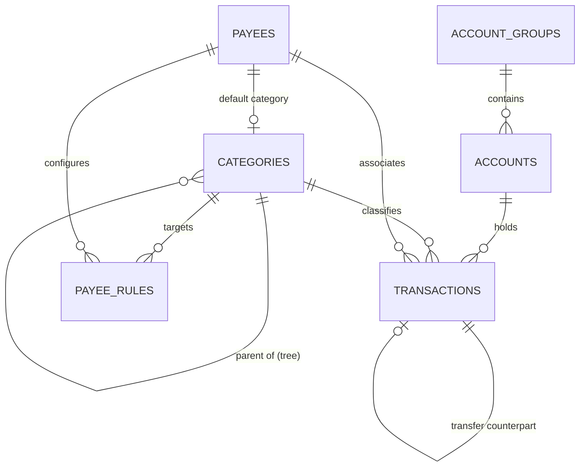

# Buddy Architecture & Technical Design

This document provides a deep technical overview of **Buddy**, explaining the system architecture, core engineering concepts, database design, domain algorithms, and internal data flows.

---

## 1. Architectural Philosophy & Overview

Buddy is engineered with three primary design principles:

1. **Local-First & Data Sovereignty**: All user financial records are persisted locally in an embedded SQLite database (`./data/buddy.db`). There are no third-party cloud sync services, tracking scripts, or external dependencies required to operate.
2. **Server-First Execution with React Server Components (RSC)**: Buddy leverages Next.js 16's App Router architecture. High-cost database queries, category hierarchy rollups, and aggregations are computed on the server and streamed as server components, minimizing client-side JavaScript overhead.
3. **Type-Safe Domain Logic & Server Actions**: All data mutations (CRUD operations, reordering, CSV ingestion) are implemented as Next.js Server Actions (`'use server'`) with full end-to-end TypeScript validation through Drizzle ORM.

```
┌─────────────────────────────────────────────────────────────┐
│                    Browser Client Layer                     │
│  - React 19 Client Components ('use client')                │
│  - Optimistic State Updates & React Transitions             │
│  - Drag-and-Drop Reordering & Instant In-Memory Filtering    │
└──────────────────────────────▲──────────────────────────────┘
                               │ HTTP / Server Action RPC
┌──────────────────────────────▼──────────────────────────────┐
│                    Next.js App Router (RSC)                 │
│  - Server-Rendered Layouts & View Aggregations               │
│  - Server Actions (lib/actions/*)                            │
│  - Path Revalidation (revalidatePath)                       │
└──────────────────────────────▲──────────────────────────────┘
                               │
┌──────────────────────────────▼──────────────────────────────┐
│                    Domain Services & Logic                  │
│  - Category Tree Rollup Engine (lib/category-utils.ts)      │
│  - Payee Rule Evaluation Engine (lib/payee-rules.ts)        │
│  - CSV Normalization & Parser (lib/csv.ts)                  │
└──────────────────────────────▲──────────────────────────────┘
                               │
┌──────────────────────────────▼──────────────────────────────┐
│                   Drizzle ORM & Schema                      │
│  - Relational Mapping & Schema Definitions                  │
│  - Type Inference ($inferSelect, $inferInsert)              │
└──────────────────────────────▲──────────────────────────────┘
                               │
┌──────────────────────────────▼──────────────────────────────┐
│                SQLite Engine (better-sqlite3)               │
│  - Write-Ahead Logging (WAL mode)                           │
│  - Foreign Key Constraints Enabled                          │
│  - In-App Schema Auto-Migrator (lib/db/index.ts)            │
│  - Local Storage: ./data/buddy.db                           │
└─────────────────────────────────────────────────────────────┘
```

---

## 2. Database Layer & Schema Design

Buddy uses [`better-sqlite3`](https://github.com/WiseLibs/better-sqlite3) as the storage engine paired with [Drizzle ORM](https://orm.drizzle.team/).

### Database Initialization & Pragmas

On initialization (`lib/db/index.ts`):
- **WAL Mode (`PRAGMA journal_mode = WAL;`)**: Dramatically improves concurrent read/write performance. Readers do not block writers, and writers do not block readers.
- **Foreign Keys (`PRAGMA foreign_keys = ON;`)**: Enforces referential integrity at the database engine level.
- **Singleton Client**: In development, `globalThis.__sqliteDb` preserves the SQLite handle across Next.js Hot Module Replacement (HMR) reloads to avoid file lock contention.

### In-App Auto-Migrations

Rather than requiring manual database migrations during development, `lib/db/index.ts` inspects SQLite table schemas on connection and performs non-destructive schema migrations:
- Adds missing columns (e.g., `icon` and `exclude_from_net_worth` to `accounts`).
- Upgrades flat categories into a recursive self-referencing hierarchy (`parent_id`) while preserving existing categories and migrating legacy category groups.
- Provisions `payee_rules` and index tables.
- Adds `priority` metadata to `payees`.

### Entity Relationship Model



#### Tables

1. **`account_groups`**: High-level groupings for accounts (e.g., *Everyday Banking*, *Investments*).
   - `id` (text, PK)
   - `name` (text, not null)
   - `icon` (text, optional Lucide icon key)
   - `sort_order` (integer, default 0)
   - `created_at`, `updated_at` (timestamps)

2. **`accounts`**: Individual financial accounts.
   - `id` (text, PK)
   - `group_id` (text, FK -> `account_groups.id` on delete `SET NULL`)
   - `name` (text, not null)
   - `type` (text enum: `checking`, `savings`, `credit`, `cash`, `other`)
   - `icon` (text, optional Lucide icon key)
   - `sort_order` (integer, default 0)
   - `exclude_from_net_worth` (boolean integer, default 0)
   - `is_archived` (boolean integer, default 0)
   - `created_at`, `updated_at` (timestamps)

3. **`categories`**: Recursive self-referencing spending taxonomy.
   - `id` (text, PK)
   - `parent_id` (text, FK -> `categories.id` on delete `CASCADE`)
   - `name` (text, not null)
   - `sort_order` (integer, default 0)
   - `is_archived` (boolean integer, default 0)
   - `created_at` (timestamp)

4. **`payees`**: Transaction counter-parties with default category mappings and priorities.
   - `id` (text, PK)
   - `name` (text, unique, not null)
   - `default_category_id` (text, FK -> `categories.id` on delete `SET NULL`)
   - `priority` (integer, default 1; 0=Highest, 1=Standard, 2=Low, 3=Archived)
   - `created_at` (timestamp)

5. **`payee_rules`**: Conditional amount-based categorization rules per payee.
   - `id` (text, PK)
   - `payee_id` (text, FK -> `payees.id` on delete `CASCADE`)
   - `category_id` (text, FK -> `categories.id` on delete `CASCADE`)
   - `operator` (text enum: `lte`, `gte`)
   - `amount_cents` (integer, not null)
   - `sort_order` (integer, default 0)
   - `created_at` (timestamp)

6. **`transactions`**: Double-entry financial records and transfers.
   - `id` (text, PK)
   - `account_id` (text, FK -> `accounts.id` on delete `CASCADE`)
   - `payee_id` (text, FK -> `payees.id` on delete `SET NULL`)
   - `category_id` (text, FK -> `categories.id` on delete `SET NULL`)
   - `amount_cents` (integer, signed; negative = outflow, positive = inflow)
   - `date` (text, `YYYY-MM-DD`)
   - `notes` (text, optional)
   - `is_cleared` (boolean integer, default 1)
   - `transfer_id` (text, self-reference linking paired transfer record)
   - `created_at`, `updated_at` (timestamps)

---

## 3. Core Technical Concepts & Domain Logic

### 3.1 Monetary Representation & Currency Precision

- **Integer Cents**: Monetary values are **never** stored as floating-point numbers (`REAL` or `FLOAT`). All monetary calculations are performed in integer cents (`amountCents`).
- **Sign Convention**:
  - `amountCents < 0`: Outflow / Expense / Debit
  - `amountCents > 0`: Inflow / Income / Credit
- **Zero-Cents Protection**: Inputs in UI components (`CurrencyInput.tsx`) parse raw user input directly into integer cents using regex and round-half-up math to prevent rounding bugs.
- **Formatting**: `lib/utils/currency.ts` formats cents into localized currency strings based on the centralized `APP_CONFIG` in `lib/constants.ts`.

### 3.2 Category Tree Hierarchy & Aggregation Engine

Categories are modeled as an **Adjacency List** with self-referencing `parent_id` pointers, supporting arbitrary tree depth (Roots $\rightarrow$ Subcategories $\rightarrow$ Sub-subcategories, etc.).

#### Recursive Metrics & Rollups (`lib/category-utils.ts`)

When categories are fetched (`getCategoryTree()` in `lib/actions/categories.ts`):
1. All active categories and raw direct transaction stats (`directSpentCents`, `directTransactionCount`) are loaded from SQLite.
2. An in-memory tree of `CategoryNode` items is constructed using a parent-child adjacency map.
3. `processCategoryNode()` recursively traverses the tree:
   - Computes node `depth` (`0` for root, `1` for child, etc.).
   - Computes breadcrumb `path` (`['Housing', 'Utilities', 'Power']`).
   - Computes human-readable `fullPathName` (`"Housing > Utilities > Power"`).
   - Aggregates **rollup totals**:
     $$\text{totalSpentCents} = \text{directSpentCents} + \sum_{\text{child}} \text{child.totalSpentCents}$$
     $$\text{totalTransactionCount} = \text{directTransactionCount} + \sum_{\text{child}} \text{child.totalTransactionCount}$$

#### Category Subtree Filtering

When filtering transactions by category in `TransactionTable.tsx`, selecting a parent category (e.g. `Housing`) must match all transactions categorized under `Housing` **or any descendant subcategory**.
- The component precalculates an in-memory `categorySubtreeMap: Map<string, Set<string>>` where each category ID maps to a `Set` containing itself and all its descendant IDs.
- Ledger filtering checks `subtreeSet.has(transaction.categoryId)` in $\mathcal{O}(1)$ time.

### 3.3 Smart Payees & Rule Matching Engine

Payees are configured with a priority classification and conditional rules (`lib/payee-rules.ts`).

#### Payee Priority Tiers

| Tier | Priority | Semantic Meaning & Behavior |
|---|---|---|
| **Highest** | `0` | Quick-picks: displayed before user enters text in selection dropdowns |
| **Standard** | `1` | Standard auto-complete search results |
| **Low** | `2` | Deprioritized to bottom of suggestions |
| **Archived** | `3` | Hidden from selection comboboxes; retained on historical records |

#### Amount-Based Rule Evaluation (`resolvePayeeCategory`)

When a user selects a payee and enters an amount (or imports a transaction via CSV):
1. Checks the payee's rules against the absolute transaction amount $|amountCents|$.
2. Evaluates rules with operators:
   - `lte`: $|amountCents| \le \text{rule.amountCents}$
   - `gte`: $|amountCents| \ge \text{rule.amountCents}$
3. **Closest Threshold Matching**: If multiple rules match, Buddy sorts matching rules by mathematical distance to the threshold:
   $$\text{distance} = \big| |amountCents| - \text{rule.amountCents} \big|$$
   The rule with the minimal distance wins.
4. **Fallback**: If no rule matches, Buddy falls back to the payee's `defaultCategoryId`.

### 3.4 Double-Entry Linked Transfers

Transfers between accounts are executed as two synchronized atomic records:
1. **Source Outflow**: A transaction on `sourceAccountId` with `-amountCents`.
2. **Destination Inflow**: A transaction on `destinationAccountId` with `+amountCents`.
3. **Linkage**: Both records store the ID of the counterpart record in `transfer_id`.


When a user updates or deletes a transfer transaction, `transactions.ts` identifies the counterpart record via `transfer_id` and keeps both sides synchronized.

### 3.5 CSV Ingestion Pipeline

The CSV parser (`lib/csv.ts` and `lib/actions/csv-import.ts`) handles flexible bank statement imports:

1. **Header Normalization**: Strips spaces, underscores, and dashes, mapping varied bank headers to standard keys:
   - Date: `Date`, `TxDate`, `Transaction Date`
   - Description: `Description`, `Desc`, `Memo`, `Details`
   - Payee: `Payee`, `Merchant`, `Counterparty`
   - Account: `Account`, `Source Account`
   - Destination Account: `Transfer Account`, `Transfer To`, `Destination Account`
   - Amount: `Amount`, `Total`, `Sum`
2. **Date Normalization**: Parses formats (`YYYY-MM-DD`, `DD/MM/YYYY`, `MM/DD/YYYY`, `YYYY/MM/DD`, with or without timestamps) into strict ISO `YYYY-MM-DD`.
3. **Entity Reconciliation & Preloading**:
   - Existing accounts, categories, and payees are preloaded into memory before processing.
   - Lookups use normalized lowercase keys to prevent duplicates.
   - Missing accounts, categories, or payees are auto-provisioned in batch with sensible defaults.
4. **Note Merging**: Merges descriptions and memo fields using `\n\n` separators to preserve statement history.
5. **Rule Execution**: Evaluates payee categorization rules on imported rows before committing to the database.

---

## 4. Deep Project Structure

```text
buddy/
├── app/                                 # Next.js 16 App Router
│   ├── favicon.ico                      # Application favicon
│   ├── globals.css                      # Tailwind CSS v4 directives & theme variables
│   ├── layout.tsx                       # Root layout (renders Navbar, loads active entities)
│   ├── page.tsx                         # Dashboard / Overview page (balances & recent activity)
│   ├── accounts/
│   │   └── page.tsx                     # Account management page (server loader)
│   ├── categories/
│   │   └── page.tsx                     # Standalone category tree view (redirects / aliases)
│   ├── manage/
│   │   └── page.tsx                     # Unified category & payee management page
│   └── transactions/
│       └── page.tsx                     # Full transaction ledger view with server-side filters
│
├── components/                          # React Client & Presentation Components
│   ├── AccountGroupModal.tsx            # Modal for creating/editing account groups
│   ├── AccountIcon.tsx                  # Dynamic icon renderer for account types & custom icons
│   ├── AccountModal.tsx                 # Modal for creating/editing accounts
│   ├── AccountsClientView.tsx           # Accounts view with HTML5 drag-and-drop reordering
│   ├── CategoriesClientView.tsx         # Collapsible category tree with rollup indicators
│   ├── CategoryCombobox.tsx             # Searchable hierarchical category selector dropdown
│   ├── CategoryModal.tsx                # Modal for creating/editing categories and parent assignment
│   ├── CsvImportModal.tsx               # Drag-and-drop CSV uploader with preview diagnostics
│   ├── CurrencyInput.tsx                # Controlled currency input parsing directly to cents
│   ├── DeleteAccountGroupModal.tsx      # Confirmation modal for deleting account groups
│   ├── DeleteAccountModal.tsx           # Confirmation modal for deleting accounts
│   ├── DeletePayeeModal.tsx             # Confirmation modal for deleting payees
│   ├── GroupIcon.tsx                    # Dynamic icon renderer for account groups
│   ├── IconPicker.tsx                   # Visual grid picker for Lucide icon selection
│   ├── ManageClientView.tsx             # Tabbed coordinator for Categories and Payees tabs
│   ├── Navbar.tsx                       # Sticky navigation header with mobile drawer & quick-action
│   ├── PayeeCombobox.tsx                # Combobox with priority badges and quick-picks
│   ├── PayeeModal.tsx                   # Modal for editing payee rules, priority, and default category
│   ├── PayeesTab.tsx                    # Payee directory with search, filters, and rule count badges
│   ├── RecentTransactionsList.tsx       # Compact transaction list for the dashboard overview
│   ├── TransactionDetailModal.tsx       # Modal showing complete transaction audit trail & transfer links
│   ├── TransactionModal.tsx             # Modal for recording expenses, income, and transfers
│   ├── TransactionTable.tsx             # Full data table with instant search and inline status toggling
│   └── TransactionsClientView.tsx       # Transaction ledger coordinator layout
│
├── lib/                                 # Core Business Logic & Infrastructure
│   ├── actions/                         # Next.js Server Actions ('use server')
│   │   ├── account-groups.ts            # Queries and mutations for account groups & reordering
│   │   ├── accounts.ts                  # Queries and mutations for accounts & balance calculations
│   │   ├── categories.ts                # Tree generation, category mutations, and archiving
│   │   ├── csv-import.ts                # CSV transaction ingestion & entity auto-provisioning
│   │   ├── payees.ts                    # Payee directory queries, mutations, and rule management
│   │   └── transactions.ts              # Ledger queries, filters, transfer pairing, and mutations
│   ├── db/                              # Database layer
│   │   ├── index.ts                     # better-sqlite3 instance, WAL pragma, and auto-migrations
│   │   ├── schema.ts                    # Drizzle schema, table relations, and inferred TypeScript types
│   │   └── seed.ts                      # Idempotent development seeder with sample data
│   ├── category-utils.ts                # Hierarchy traversal, rollup computation, tree flattening
│   ├── constants.ts                     # System configuration, currency formats, account icon lists
│   ├── csv.ts                           # PapaParse wrapper, header normalizer, date parsers
│   ├── payee-rules.ts                   # Amount rule engine, threshold distance calculator, priority meta
│   └── utils/
│       ├── currency.ts                  # Formatters for integer cents to localized currency strings
│       └── utils.ts                     # Utility helpers (clsx/tailwind-merge wrapper)
│
├── data/                                # Persistent storage directory (git-ignored)
│   └── buddy.db                         # Active SQLite database file
│
├── docs/
│   └── ARCHITECTURE.MD                  # Detailed technical architecture (this document)
├── drizzle.config.ts                    # Drizzle Kit configuration pointing to schema & SQLite file
├── package.json                         # Project dependencies, build targets, and scripts
├── tsconfig.json                        # TypeScript configuration with `@/*` path alias
└── README.md                            # High-level product and user-focused documentation
```

---

## 5. Performance Optimizations

1. **SQLite WAL Mode**: Multiple server actions and concurrent component renders read from `./data/buddy.db` concurrently without blocking or locking.
2. **Precomputed Adjacency Rollups**: Category rollups are calculated in a single linear recursive pass ($\mathcal{O}(N)$ where $N$ is total categories) rather than executing recursive SQL queries against SQLite.
3. **In-Memory Ledger Filtering**: The transaction ledger pre-loads recent transactions on server render and executes instant client-side filtering and search in memory, avoiding server roundtrips for search queries.
4. **Optimistic Drag-and-Drop**: Reordering accounts and groups updates local React state immediately while persisting the new sort order asynchronously via Server Actions with `useTransition`.
